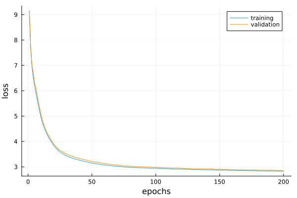

# Example: Neural Posterior Estimation

Normalizing Flows can be use for Neural Posterior Estimation when the number of parameters in the model are around or less than 10. For this example, let us assume that we have the following simulated data

```@example 1; continued=true
parameters = ["a", "λ", "ω", "φ", "b"]

function simulate_decay_sine(
    θ::AbstractArray{T}; 
    n::Int=20, 
    tmax::T=T(5.0), 
    σ::T=T(0.1)
    ) where {T}
    
    # parameters
    a = θ[1, :]
    λ = θ[2, :]
    ω = θ[3, :]
    φ = θ[4, :]
    b = θ[5, :]

    t = range(zero(T), tmax, n)
    
    x = a .* exp.(-4 .* λ .* t) .* sin.(50 .* ω .* t .+ φ) .+ b 
    return x .+ σ .* randn(T, n)

end

# generate a mock observation ...
θ_true = [0.5f0, 0.4f0, 0.3f0, 0.5f0, 0.5f0]
x_true = simulate_decay_sine(θ_true, n=30, tmax=1f0, σ = 0.1f0)[:, 1]

# and run many simulations stored in parameter θs and xs
m = 10000

max_val = Dict(p => 1f0 for p in parameters)
min_val = Dict(p => 0f0 for p in parameters)

θs = zeros(T, 5, m)

# define a uniform flat prior in [0, 1] for all parameters
for (i, p) in enumerate(parameters)
    θ[i, :] .= (max_val[p] - min_val[p]) .* rand(T, m) .+ min_val[p]
end

xs = simulate_decay_sine(θ; n=n, kws...)
```

Let us now use *DensityFlows* to emulate the posterior distribution from the sample. The first step is to define the [`DataArrays`](@ref) object from both ``x`` and ``\theta`` and the [`FlowChain`](@ref). In the FlowChain one can either put [`CouplingBlock`](@ref)s or series of [`CouplingLayer`](@ref)s making sure that we suffle the transformed dimensions as we do here.

```@example 1
using DensityFlows

data = DataArrays(θs, xs)
n_hidden_dim = 32

# create the model
chain = FlowChain(
    CouplingLayer(data, [1, 2], hidden_dim_s=n_hidden_dim,  hidden_dim_t=n_hidden_dim), 
    CouplingLayer(data, [3, 4], hidden_dim_s=n_hidden_dim,  hidden_dim_t=n_hidden_dim), 
    CouplingLayer(data, [1, 5], hidden_dim_s=n_hidden_dim,  hidden_dim_t=n_hidden_dim), 
    CouplingLayer(data, [2, 3], hidden_dim_s=n_hidden_dim,  hidden_dim_t=n_hidden_dim),
    CouplingLayer(data, [4, 5], hidden_dim_s=n_hidden_dim,  hidden_dim_t=n_hidden_dim),
    NormalizationLayer(data, -1f0, 1f0)
    )

# create and print a summary of the flow
@summary flow = Flow(chain, data)
```

Training is performed with the [`train!`](@ref) function, after setting the optimizer.

```julia
state = Optimisers.setup(Optimisers.Adam(1f-4), flow.model)
@grad_clamping train!(flow, data, state, epochs=50)
```

The train and validation loss can be obtained as shown below.

```julia
p = plot()
plot!(p, training_loss(flow))
plot!(p, validation_loss(flow))
```




Finally, we can compare the reconstructed distribution (dark contours) to the _true_ distribution (light contours). We can see that in that case a sample of 2000 points is enough to have a good emulator of the _true_ distribution. 


New points can be sampled using
```julia
x_new_1 = sample(flow, 1000, (-1f0,))
x_new_2 = sample(flow, 1000, (2f0,))
```

